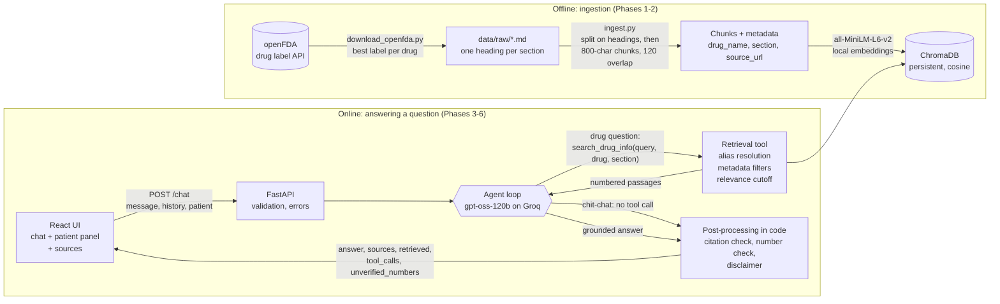
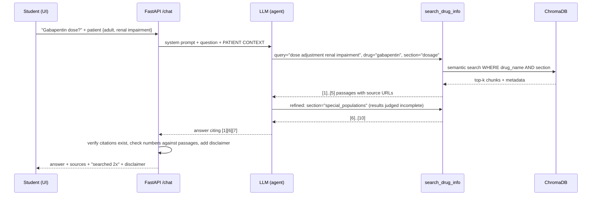

# MediDose AI

An **agentic RAG** assistant for pharmacology and medical students. Ask about a drug's
indications, dosage, side effects, interactions or contraindications and get answers
grounded **only** in FDA drug labels, each claim citing the passage it came from. Enter patient
parameters (age group, weight, renal/hepatic impairment) to get the label's dosage guidance for that case.

> ⚠️ **Educational use only.** Not medical advice. Always consult the official label and a qualified clinician.

**At a glance:** 30 drugs · 2,292 indexed passages · LLM decides when to retrieve · 100% routing
accuracy, 99% faithfulness (LLM judge) and 100% citation validity on a 20-question evaluation · 56 pytest tests ·
100% free stack (Groq free tier, local embeddings, local ChromaDB).

---

## Architecture



How one question flows through the agent:



## Project structure

```
backend/
  config.py        all settings from .env (models, paths, chunk sizes, tokens)
  vectorstore.py   one shared embedding model + Chroma collection (ingest and search can't drift apart)
  ingest.py        load -> chunk -> embed -> index, with stats          (Phase 2)
  tools.py         search_drug_info LangChain tool + retrieve()         (Phase 3)
  prompts.py       grounding system prompt, patient-context block       (Phase 4)
  agent.py         tool-calling agent loop + citation/number checks     (Phase 4)
  app.py           FastAPI: /health, /chat, /ingest                     (Phase 5)
data/
  drug_list.json       30 drugs + aliases (paracetamol -> acetaminophen)
  download_openfda.py  openFDA downloader                               (Phase 1)
  raw/  chroma/        generated (git-ignored)
frontend/          React + Vite chat UI                                 (Phase 6)
eval/              questions.json (20 gold questions) + evaluate.py     (Phase 7)
tests/             56 pytest tests: chunking, retrieval, agent, API     (Phase 8)
```

## Quickstart (Windows / PowerShell)

Prerequisites: Python 3.11+ (developed on 3.12), Node.js 18+, a free Groq API key
(https://console.groq.com/keys).

```powershell
# 1. Python environment
py -3.11 -m venv .venv
.\.venv\Scripts\Activate.ps1          # if blocked: Set-ExecutionPolicy -Scope CurrentUser RemoteSigned
pip install -r requirements.txt       # first install pulls PyTorch; a few minutes

# 2. Secrets
Copy-Item .env.example .env           # then set GROQ_API_KEY in .env

# 3. Data + index (~2 minutes)
python -m data.download_openfda       # 30 FDA labels -> data/raw
python -m backend.ingest              # chunks + embeddings -> data/chroma

# 4. Check everything works (no API key or network needed)
pytest

# 5. Run (two terminals)
uvicorn backend.app:app --port 8000   # API, docs at http://localhost:8000/docs
cd frontend; npm install; npm run dev # UI at http://localhost:5173
```

Other entry points: `python -m backend.tools "query" --drug warfarin` (retrieval only),
`python -m backend.agent --demo` (agent decisions in the terminal),
`python -m eval.evaluate` (evaluation).

## Key design decisions (summary)

| Question | Decision and why |
|---|---|
| **Why RAG instead of fine-tuning?** | (1) **Verifiability:** every answer cites the exact label passage, and a fine-tuned model can't show where a fact came from. (2) **Updatability:** labels change; RAG updates by re-running ingestion in ~2 minutes, while fine-tuning means retraining. (3) **Hallucination control:** the model is told to answer *only* from retrieved text and to refuse otherwise. Fine-tuning teaches style and patterns but doesn't stop a model from producing plausible wrong doses. (4) **Cost:** no GPUs or training data; works on a free tier. |
| **Why agentic RAG instead of "always retrieve"?** | The LLM decides **whether** to retrieve (no search for "hi"), **how** (it chooses `drug_name`/`section` filters, e.g. maps "who should not take" → `contraindications`), and **whether to search again** (refinement when results are weak; separate searches for each drug in an interaction). Evaluation: 100% routing accuracy; the agent fixed retrieval misses that plain semantic search made (q08). Trade-off: more latency and tokens than single-shot RAG, so searches are capped at 3. |
| **Why ChromaDB?** | Embedded (no server to run), persists to disk, native metadata `where` filters (needed for drug/section filtering), first-class LangChain integration, free. At ~2.3k chunks an HNSW index answers in milliseconds; a hosted vector DB would add cost and operations for no gain at this scale. |
| **Why 800-char chunks with 120 overlap?** | **Measured:** `all-MiniLM-L6-v2` silently truncates after 256 tokens and label text is token-dense. A sweep gave 1000 chars → 8.3% of chunks truncated, 800 → 1.2%, 600 → 0.3% but fragmented. 800 chars holds about one label subsection; 15% overlap keeps sentences that straddle a boundary whole in one chunk. Splitting on section headings *first* gives every chunk one truthful `section` tag. |
| **Why local embeddings + Groq?** | Both free. Local embeddings mean no data leaves the machine and no rate limits at ingestion; Groq gives fast inference of open-weight models with tool calling. Models are configurable in `.env` (Groq retired the originally planned Llama model mid-project, a one-line change). |
| **How are hallucinations controlled?** | Defence in depth: grounding prompt (answer only from passages, cite, fixed refusal sentence) → unknown drugs refused by the tool, not guessed → relevance cutoff so weak matches come back as nothing → **checks in code**: fake citations flagged, every number in the answer compared with the passages (`unverified_numbers`) → disclaimer added by code → sources and passage text shown to the user → measured by an independent LLM judge (99% faithful). |

---

# Build log (phase by phase)

*Each phase records what was built, why, and what broke along the way.*

## Phase 1 — Data acquisition

```powershell
python -m data.download_openfda              # all 30 drugs
python -m data.download_openfda warfarin     # a single drug
```

Output per drug in `data/raw/`: `<drug>.json` (raw openFDA record + provenance) and
`<drug>.md` (normalised text, one `## <section>` heading per clinical section).

### Design decisions

| Decision | Why |
|---|---|
| **openFDA drug labels** as the source | FDA-approved package inserts: authoritative, **public domain**, free API, and already split into named fields (dosage, adverse reactions, ...). |
| **One best label per drug** | openFDA has dozens of labels per drug (every manufacturer, every combo). Near-duplicate chunks would fill the top-k with the same text. We score candidates on: single-ingredient → completeness of key sections → newest → most text. |
| **Prescription first, OTC fallback** | Rx labels have full clinical sections (adverse reactions, interactions, specific populations). OTC "Drug Facts" are thinner, used only when no Rx label exists (aspirin). |
| **Canonical section names** | Rx and OTC labels use different field names. Mapping them to a fixed vocabulary (`indications, dosage, contraindications, warnings, side_effects, interactions, special_populations, overdose, pharmacology, boxed_warning`) means the retrieval tool can filter by `section` regardless of label format. |
| **Markdown with `##` headings** | Phase 2's chunker splits on headings *first*, so a chunk never mixes dosage text with side-effect text, and each chunk inherits a clean `section` tag. |
| **DailyMed URL as `source_url`** | Every label has a `set_id`; the DailyMed page is human-readable, so students can click a citation and verify it. |
| **Aliases** (`paracetamol` → `acetaminophen`) | US labels use US names; students (esp. outside the US) say paracetamol/salbutamol. Aliases let us resolve the name before metadata filtering. |

### Known data limitations
- **Acetaminophen** resolves to the **IV injection** label: in the US, oral paracetamol is OTC
  and its Drug Facts label lacks clinical detail. The IV label does contain detailed
  weight-based, paediatric and hepatic dosing, which suits this project.
- Labels describe one manufacturer's product/formulation (e.g. metformin ER); doses for other
  formulations may differ.
- Tables are flattened into text by openFDA, so tabular dosing reads as run-on text.

---

## Phase 2 — Ingestion

```powershell
python -m backend.ingest          # full rebuild of data/chroma from data/raw/*.md (~75 s on CPU)
python -m backend.ingest --keep   # upsert into the existing index instead
```

Pipeline (`backend/ingest.py`):

1. **Load** each `data/raw/<drug>.md` and parse its metadata header.
2. **Split on `## section` headings**, so a chunk never straddles two clinical sections.
3. **Recursive split** inside each section (800 chars, 120 overlap), preferring label subsection
   boundaries (`8.6 Renal Impairment`), then paragraphs, sentences, words.
4. **Enrich**: prefix each chunk with `[drug | section]`, attach metadata
   `drug_name, section, source_url, generic_name, product_type, aliases, chunk_index, chunk_id`.
5. **Deduplicate** exact-duplicate chunks.
6. **Embed** with local `all-MiniLM-L6-v2` and **index** in persistent ChromaDB (cosine space),
   using deterministic IDs (`warfarin:interactions:3`).

Result: **30 drugs → 2,292 chunks**, avg 615 chars / ~150 tokens, 1.3% over the embedder's
256-token limit. (2,306 before Phase 8 merged heading-only fragments into the next chunk.)

### Design decisions

| Decision | Why |
|---|---|
| **Chunk size 800 chars, overlap 120 (15%)** | Chosen by measurement, not guesswork. `all-MiniLM-L6-v2` **silently truncates input after 256 tokens**, and drug-label text is token-dense (~4 chars/token: numbers, units, drug names). A sweep showed: 1000 chars → 8.3% of chunks truncated; 800 → 1.5%; 600 → 0.3% but 63% more chunks and dosing passages fragmented. 800 holds roughly one label subsection (e.g. a full renal-dosing paragraph). The 15% overlap means a sentence cut at a boundary still appears whole in one of the two neighbouring chunks. |
| **Structure-aware splitting (headings first)** | Gives every chunk exactly one truthful `section` tag, which is what makes `section="interactions"` filtering reliable. Fixed-size splitting would mix dosage and side-effect text. |
| **Subsection-number separator** `\s(?=\d.\d [A-Z])` | openFDA flattens labels into long paragraphs, but keeps markers like `2.3 Dosage Adjustment...`; splitting there keeps clinically coherent units together. |
| **`[drug \| section]` prefix in the chunk text** | Chunks deep in a label rarely name the drug ("reduce the dose if CrCl < 30"). Putting the name in the embedded text lets drug-specific queries match, and the LLM always knows which drug a chunk is about. |
| **Metadata on every chunk** | Enables **filtered semantic search** (`drug_name="warfarin" AND section="interactions"`) and lets every answer cite its `source_url`. |
| **Local sentence-transformers** | Free, no API key, no data leaves the machine, fast on CPU; 384-dim vectors keep the index small. |
| **ChromaDB, persistent, cosine** | Embedded (no server to run), persists to disk, supports metadata `where` filters natively. Cosine because sentence-transformers are trained with it. |
| **Deterministic chunk IDs + full rebuild by default** | Re-running never duplicates data; a rebuild also removes stale chunks if chunk size or the drug list changes. |
| **Deduplication** | Labels nest fields (`pharmacokinetics` is often repeated inside `clinical_pharmacology`). Before the fix, the same passage filled 2 of the top-3 results. Fixed at the source (Phase 1) plus an exact-match guard here; this removed 533 chunks. |
| **Shared `backend/vectorstore.py`** | Ingestion and retrieval build the store from the same function, so they can never disagree on embedding model or distance metric. |

### Bugs found while building (good interview stories)
- **Regex separators + `keep_separator=False`**: LangChain re-joins split pieces using the
  separator *pattern*, which would put a literal `\s` inside chunks. Found by reading the library
  source; fixed with `keep_separator=True` and verified (0 chunks contain `\s`).
- **Duplicate chunks** crowding the top-k results (see the deduplication row above).
## Phase 3 — Retrieval tool

`backend/tools.py` defines the LangChain tool
`search_drug_info(query, drug_name=None, section=None, k=4)` plus a plain `retrieve()` function
(reused by the eval script and tests). Try it with no LLM involved:

```powershell
python -m backend.tools "maximum daily dose" --drug paracetamol --section dosage
python -m backend.tools "drugs that increase bleeding risk" --drug warfarin
python -m backend.tools "how do I bake bread"           # -> no results (below relevance threshold)
python -m backend.tools "dose" --drug semaglutide        # -> "not in the verified knowledge base"
```

### Design decisions

| Decision | Why |
|---|---|
| **The tool's docstring and arg descriptions are the prompt** | LangChain sends them to the LLM as a JSON schema. They're how the agent decides *whether* to retrieve and how to fill `drug_name` and `section`, so they're written for the model. |
| **`section` is an enum (`Literal`)** | The LLM can only choose values that exist in the metadata. A free-text field invites `"adverse_effects"`, which silently matches nothing. Invalid values that do arrive are dropped with a note instead of returning an empty result. |
| **Drug names resolved in code, not by the LLM** | Metadata filters need an exact match. `paracetamol`, `Tylenol` and `metformin hydrochloride` are mapped to canonical names via `data/drug_list.json` aliases. |
| **Unknown drug → explicit "not in knowledge base"** | Never falls back to an unfiltered search, which would return *another* drug's passages and invite a confident wrong answer. |
| **Minimum relevance 0.30** | Calibrated on 15 queries: unrelated questions peak at **0.18** even against their nearest chunk, on-topic results score **≥ 0.41**. Below the threshold, "nothing relevant" really means *no results*, which is the agent's cue to refine the query or say it has no verified information. |
| **`content_and_artifact` response** | The LLM gets compact numbered text (`[1] drug=… section=… source=…`) to cite; the API gets the same hits as structured dicts to render the Sources panel. No parsing of LLM output. |
| **`k` clamped to 1–10** | Bounds prompt size (and Groq free-tier token usage) no matter what the model asks for. |

### Additional data limitation
- **Ibuprofen** resolves to **Caldolor (IV ibuprofen)**, for the same reason as acetaminophen: oral
  ibuprofen is OTC in the US. Its interaction section (e.g. with ACE inhibitors) still applies.
## Phase 4 — Agent

Needs `GROQ_API_KEY` in `.env` (free at https://console.groq.com/keys).

```powershell
python -m backend.agent --demo                                   # 6 scripted questions, shows decisions
python -m backend.agent "What is the dose of gabapentin?" --renal
python -m backend.agent "Paracetamol dose for a child" --age-group child --weight 20
```

The log shows the agentic decision for each question:

```
USER: Hi! What can you help me with?
[DECISION] NO RETRIEVAL - answering directly
USER: What is the dose of gabapentin?  | patient={'age_group': 'adult', 'renal_impairment': True}
[DECISION] RETRIEVE -> search_drug_info(query='gabapentin dose adjustment renal impairment', drug_name='gabapentin', section='dosage')
    -> 4 passages, top relevance 0.61
[DECISION] RE-RETRIEVE (refined) -> search_drug_info(...)        # only when the model judges results insufficient
```

### How it works (`backend/agent.py`, `backend/prompts.py`)

```
user msg + PATIENT CONTEXT ─► LLM (sees tool schema) ─► tool call? ──no──► answer
                                   ▲                        │ yes (max 3)
                                   └──── numbered passages ◄┘ search_drug_info
                                                                    │
                    code post-processing: mark cited sources, flag fake citations, add disclaimer
```

### Design decisions

| Decision | Why |
|---|---|
| **Agentic RAG (LLM decides to retrieve)** | "Always retrieve" wastes a search on "hi" and stuffs irrelevant passages into the prompt; "never retrieve" means answering from model memory (unverifiable). Letting the model route gives: no retrieval for chit-chat, filtered retrieval for drug questions (it picks `drug_name`/`section`), **multiple searches** for multi-drug questions, and **query refinement** when results are weak. |
| **Hand-written tool-calling loop** on LangChain `bind_tools` | About 80 transparent lines instead of a black-box agent class. We need control a prebuilt agent hides: a hard search cap, global citation numbering, error recovery, and logging of every decision. |
| **Max 3 searches, then the model must answer** (tools unbound) | Bounds latency and Groq free-tier token usage; prevents retrieval loops. |
| **Global citation numbers** | Each search returns its own [1..k]; the loop renumbers across searches so `[3]` in the answer maps to exactly one entry in the Sources list. |
| **Invalid tool args → error returned to the model** (not raised) | The model reads the validation error and retries with a valid `section`; the user never sees a crash. |
| **Grounding system prompt** | Answer **only** from passages, **cite every factual sentence**, else reply exactly *"I don't have verified information on that."* A fixed sentence is easy to detect in evaluation. |
| **Citation + number checks in code** | The answer's `[n]` markers are compared with the sources actually retrieved (fake citations are logged), and every number in the answer is checked against the passages (`unverified_numbers`). |
| **Disclaimer added by code, not by the LLM** | Deterministic: it can't be forgotten or reworded. |
| **Patient parameters in the user turn** | They belong to this question; the system prompt stays a fixed rule set. The prompt tells the model to put them in its *search queries* (e.g. "renal impairment" → `special_populations` / `dosage`), so retrieval is personalised, not just the wording. |
| **mg/kg arithmetic allowed, invented doses not** | If the label says 15 mg/kg and the weight is 20 kg, showing "15 × 20 = 300 mg [1]" is a transparent calculation from a cited source, and the label's maximum must also be stated. Adjustments not in the label are never invented. |
| **Only text of previous turns kept as history** | Follow-ups trigger fresh retrieval instead of relying on stale passages; keeps prompts small. |
| **temperature = 0** | Repeatable, conservative outputs; better for evaluation. |

### Live testing on Groq: what broke and how it was fixed

Model: `openai/gpt-oss-120b` (`llama-3.3-70b-versatile`, the original plan, has been retired by
Groq; the model is configurable via `GROQ_MODEL`). Free tier: **8,000 tokens/minute**.

| Problem observed | Fix |
|---|---|
| gpt-oss cites in its native format `【1†L1-L4】`, so 0 citations were detected | `normalise_citations()` converts to `[1]`; prompt demands plain `[n]` |
| Empty final answer after the search budget was spent (tools had been unbound) | Keep tools bound with `tool_choice="none"`; one explicit retry; else the no-info sentence |
| "ibuprofen + lisinopril" found nothing: labels say **"ACE inhibitors"**, not "lisinopril" (score 0.29 vs 0.64 for the class name) | Prompt tells the agent to search by **drug class** (a pharmacology insight, not a threshold hack) |
| Rate limiting (429) and a crash | `k` capped at 5, repeated passages sent as "same as [n]", `reasoning_effort=low`, client retries with backoff, and `AgentError` instead of a crash |
| **Hallucination:** gabapentin's renal-dosing table is an *image* in the label, so its values were never in our data, yet the model produced a full (wrong) CrCl table from memory and cited `[1]` | (1) Prompt: every number must appear in a passage; if a passage points to a missing table, say so. (2) **`check_numbers()` in code**: any number in the answer not found in the retrieved passages (allowing weight × mg/kg arithmetic) is returned as `unverified_numbers` and logged. After the fix the model answers *"the precise reduced doses are not available here"* |
| Invented formulation ("oral solution, tablet" for an IV-only label) | Prompt: no formulations/routes/advice not stated in passages |

**Residual risk (honest):** the model may still add a conversational verdict (e.g. *"can be taken
together"*) despite the prompt. `check_numbers` verifies a number *exists* in the sources, not that it
is used in the right context. Phase 7 measures faithfulness properly.

### Verified without an LLM
A scripted fake LLM confirmed: chit-chat triggers no retrieval; an invalid `section` is returned
to the model as an error and the retry succeeds; numbering continues across searches; a fake
citation `[9]` is flagged; a request for 4 searches is capped at 3; patient context reaches the prompt.
## Phase 5 — API

```powershell
uvicorn backend.app:app --reload --port 8000
# then open http://localhost:8000/docs  (interactive Swagger UI)
```

| Endpoint | Purpose |
|---|---|
| `GET /health` | Readiness: chunk count, drug count, model, whether the LLM key is set. No LLM call, so it's free. |
| `POST /chat` | `{message, history, patient}` → `{answer, sources[], retrieved, tool_calls[], unverified_numbers[], disclaimer}` |
| `POST /ingest` | Rebuild the index (`{"download": true}` re-fetches openFDA first). Protected by `X-Admin-Token` if `ADMIN_TOKEN` is set. |

Example (PowerShell):

```powershell
$body = @{ message = "What is the dose of gabapentin?"
           patient = @{ age_group = "adult"; weight_kg = 70; renal_impairment = $true } } | ConvertTo-Json
Invoke-RestMethod -Method Post -Uri http://localhost:8000/chat -ContentType "application/json" -Body $body
```

Each `sources[]` item: `id` (matches `[n]` in the answer), `drug_name`, `section`, `source_url`,
`score`, `text` (the passage itself, so a student can check the claim), `cited`.

### Design decisions

| Decision | Why |
|---|---|
| **Pydantic request/response models** | The API contract. Bad input (`weight_kg: -5`, `age_group: "toddler"`, empty message) is rejected with 422 *before* any LLM tokens are spent; `/docs` is generated from the same models. |
| **Stateless: client sends `history`** | No server-side sessions to store, expire or leak between users; any instance can serve any request (horizontal scaling). History is capped (50 turns in, last 6 used). |
| **`retrieved` and `tool_calls` in the response** | Makes the agent's decision visible to the UI and the demo, not just the logs. |
| **Sync `def` endpoints** | The agent does blocking I/O (Groq) and CPU work (embeddings). FastAPI runs sync endpoints in a thread pool, so one slow chat doesn't freeze the event loop. |
| **Warm-up at startup** (`lifespan`) | Loads the embedding model and opens Chroma once, so the first user doesn't wait about 10 s. |
| **Honest status codes** | 422 invalid input · 503 Groq rate limit/outage or index rebuilding (retryable) · 409 ingest already running · 401 bad admin token · 500 misconfiguration. |
| **Ingest lock** | While `/ingest` rebuilds, `/chat` returns 503 instead of reading a half-built collection; a second ingest gets 409. |
| **Validation errors don't echo the input** | Found in testing: a lone Unicode surrogate in `history` made FastAPI's default 422 handler crash with **500** while echoing the input. The custom handler returns only `loc/msg/type`, which is safer and can't crash. |
| **CORS restricted** to the Vite dev origin (configurable via `CORS_ORIGINS`) | Only the frontend can call the API from a browser. |

### Verified
`/health` ok (2,306 chunks, 30 drugs) · invalid patient/message → 422 with field locations · greeting →
`retrieved: false` · elderly + renal metformin question → cited contraindication (eGFR < 30) ·
follow-up "What about its side effects?" resolved *its = metformin* from `history` · chat during
ingest → 503 · concurrent ingest → 409 · ingest rebuilt 2,306 chunks in 46 s.
## Phase 6 — Frontend

Requires Node.js 18+. Run the API and the UI in **two terminals**:

```powershell
# terminal 1 (project root, venv active)
uvicorn backend.app:app --reload --port 8000

# terminal 2
cd frontend
npm install        # first time only
npm run dev        # http://localhost:5173
```

React 19 + Vite, no UI framework. Files in `frontend/src/`:

| File | Role |
|---|---|
| `App.jsx` | Chat state, history, example questions, health indicator, disclaimer banner |
| `api.js` | The only place that talks HTTP; turns FastAPI 422/503 errors into readable messages |
| `components/PatientPanel.jsx` | Age group, weight, renal/hepatic flags, with an **on/off switch** |
| `components/Message.jsx` | Renders markdown answers (incl. tables), clickable `[n]` citations, the agent-decision line, unverified-number warning |
| `components/Sources.jsx` | Sources under each answer: cited first, expandable passage text, DailyMed link |

### Design decisions

| Decision | Why |
|---|---|
| **Vite dev proxy (`/api` → `:8000`)** | The frontend never hard-codes the backend URL, and in development the browser sees one origin. `VITE_API_URL` overrides it for deployment. |
| **Agent decision shown on every answer** | "🔎 Searched the drug labels 2× (refined the query): gabapentin/dosage, gabapentin/special_populations" or "💬 Answered without retrieval". It makes the agentic behaviour visible in a demo, not only in server logs. |
| **Clickable citations → highlighted passage** | Clicking `[1]` opens and highlights the exact passage the model was given, so the student can verify the claim in one click. That's the point of grounding. |
| **Passage text shown, not just a link** | A DailyMed link opens a 40-page label; the passage shows the exact sentence. Both are provided. |
| **Cited vs "also retrieved"** | Uncited passages are collapsed, which reduces noise while staying transparent about what the model saw. |
| **Patient panel on/off switch + tag on each question** | Prevents parameters left over from an earlier case from silently personalising a new question; the tag shows which parameters each answer used. |
| **Unverified-number warning** | Surfaces the backend's `check_numbers` result to the user instead of hiding it in logs. |
| **Disclaimer twice** (banner + per answer) | The banner sets context; the per-answer line survives screenshots and copy-paste. |
| **Stateless history from the client** | Matches the stateless API; only the last 6 turns, without errors, are sent. |
| **No component library, CSS variables, dark mode** | Small bundle (~120 kB gzipped), nothing to learn for reviewers, respects OS theme. |

### Bug found while testing
On narrow screens the patient panel stayed `position: sticky` and covered the chat. The media-query
override was **earlier in the CSS than the base rule** with equal specificity, so it lost the cascade.
Fixed by placing the override after the base rule (verified via `getComputedStyle`).
## Phase 7 — Evaluation

```powershell
python -m eval.evaluate --retrieval-only   # no LLM: fast, free, deterministic
python -m eval.evaluate                    # full: retrieval + agent + LLM-judge faithfulness (~5 min on free tier)
python -m eval.evaluate --report           # re-score + re-print the last run with no API calls
```

`eval/questions.json` has **20 questions**: 18 drug questions across 9 categories (3 with patient
parameters), 1 out-of-scope drug (semaglutide → must refuse), 1 chit-chat (→ must not retrieve).
Each has `expected_drug`, `expected_sections`, and `expected_facts` (each fact is a list of accepted
wordings, e.g. `["arthralgia", "joint pain"]`). **Every expected fact was checked against the
actual label text** (the script re-validates the gold set on each run). The only fact absent from the
label is "300 mg", which is computed (15 mg/kg × 20 kg).

### What is measured (three layers, so a failure can be traced to its cause)

| Layer | Metric | Meaning |
|---|---|---|
| 1. Retrieval (no LLM) | drug hit@4, drug+section hit@4, MRR, fact recall@4 | Raw question embedded and searched, **unfiltered** (plain RAG) and **drug-filtered** (as the agent does). Are the right passages and facts in the top 4? |
| 2. Agent | routing accuracy | Retrieved when it should, didn't for chit-chat |
| | agent retrieval hit | Did the agent's *own* searches reach the expected drug+section? |
| | answer fact recall | Share of expected facts present in the answer |
| | refusal | Out-of-scope drug → "I don't have verified information" |
| | citations valid / coverage | No `[n]` pointing at nothing / share of sentences with a citation |
| 3. Faithfulness | LLM-as-judge | A **separate model** (`gpt-oss-20b`) splits the answer into claims and marks each SUPPORTED/UNSUPPORTED by the retrieved passages. A different model reduces self-preference bias and uses a separate free-tier rate-limit bucket. |

### Results (agent `gpt-oss-120b`, judge `gpt-oss-20b`, k = 4)

**Retrieval only:**

| | drug hit@4 | drug+section hit@4 | MRR | fact recall@4 |
|---|---|---|---|---|
| Unfiltered | 100% | 89% | 0.86 | 84% |
| Drug-filtered | 100% | 89% | 0.89 | 84% |

**Agent + faithfulness, before → after the fixes below:**

| Metric | Run 1 | Run 2 (final) |
|---|---|---|
| Routing accuracy (20 q) | 100% | **100%** |
| Agent retrieval hit (drug+section) | 89% | **94%** (q16 = gold-set issue, see below) |
| Answer fact recall | 81% (92% after scorer fix) | **100%** |
| Out-of-scope refusal | 100% | **100%** |
| Citations valid (no fake `[n]`) | 100% | **100%** |
| Citation coverage (sentences with `[n]`) | 47% | **46%** |
| Faithfulness (LLM judge) | 98% (1/99 claims unsupported) | **99%** (1/68 claims unsupported) |
| Answers with unverified numbers | 1/18 | **0/18** |
| Mean latency | 12.2 s | 13.9 s (mostly free-tier rate-limit waits) |

### What the evaluation found, and what was done

| Finding | Type | Action |
|---|---|---|
| q05/q06 scored 0% fact recall with correct answers: gpt-oss writes `4000<narrow-nbsp>mg` and `15 mg /kg` | **Scorer bug** | Unicode NFKC normalisation in the scorer; `--report` re-scores saved answers without new LLM calls |
| q11 *"What is the boxed warning for ciprofloxacin?"* → refused. The agent searched `section=boxed_warning` with query "boxed warning"; terse queries score 0.10–0.14 even in the right section, overlapping nonsense queries (0.04–0.15), so the 0.30 cutoff removed everything | **System bug** | When **both** drug and section filters are set, the metadata guarantees topicality, so the score cutoff is skipped. Prompt asks for descriptive clinical queries. q11 now answered in 1 search |
| q18 agent searched `side_effects` instead of `warnings` | System | Prompt hint; now searches `warnings` |
| q08/q11 retrieval misses: "who should **not take**" vs label's "**contraindicated**" (vocabulary gap) | Retrieval limit | **Experiment:** plain-language section titles in chunk headers. Result **mixed** (fact recall@4 84→90%, but section hit 89→83%, MRR 0.89→0.82), designed after seeing failures → **reverted**. The agent closes this gap itself by choosing `section="contraindications"` (q08 agent hit: yes), which is an argument *for* the agentic design |
| q03 "estimated glomerular filtration rate" not matched by fact `eGFR`; q16 fetal-toxicity text found in `warnings`, not in the expected sections | **Gold-set gaps** | Added the synonym and the section. These widen what counts as correct *after* seeing answers, so they're disclosed here. q16's agent-hit flips on the next full run |
| q18 answer added "rare" and a textbook definition not in the passages | **Real unfaithfulness** | Caught by the judge; left as a known limitation |
| Run 1 judge flagged q16 "contraindicated in pregnancy"; run 2 accepted a similar claim | **Judge noise** | An LLM judge is itself non-deterministic; on 20 questions a few points' difference is noise |

### Honest caveats
- **20 questions is a smoke test, not a benchmark**: one question = 5–6 percentage points.
- The gold set was written by the developer, against the same labels the system uses.
- **Citation coverage is only ~46%**: the model often cites once per paragraph rather than per
  sentence. Per-sentence citations are listed under future work.
- Fact recall is keyword matching: it shows facts are *present*, not that they are used correctly.
  That's what the faithfulness judge is for.
## Phase 8 — Tests

```powershell
pytest                    # all 56 tests (~15 s)
pytest -m "not index"     # 43 tests that need no built index (e.g. a fresh clone / CI)
pytest tests/test_api.py  # one file
```

| File | Tests | What it covers |
|---|---|---|
| `tests/test_chunking.py` | 10 | header/section parsing; chunks never mix sections; size bound; overlap between neighbours; split at `2.2 Renal…` subsection markers; no `\s` separator leak; no heading-only chunks; deterministic unique IDs; duplicate removal |
| `tests/test_retrieval.py` | 19 | alias/brand/salt resolution; unknown drug → note, never unfiltered fallback; metadata filters applied; off-topic → empty; drug+section filters bypass the cutoff; invalid section ignored; `k` clamped; tool returns text + artifact; section enum in the LLM schema; repeated passages not re-sent |
| `tests/test_agent.py` | 13 | chit-chat → no retrieval; retrieve → cited sources marked; invalid tool args → model recovers; citation numbers continue across searches; search cap + `tool_choice="none"`; empty answer → refusal sentence; patient context and history reach the prompt; gpt-oss `【1†…】` citations normalised; number check accepts mg/kg arithmetic and flags invented values |
| `tests/test_api.py` | 14 | response shape and disclaimer; request reaches the agent intact; 6 invalid inputs → 422 *before* the agent runs; lone-surrogate input → 422 not 500; LLM failure → 503; chat during ingest → 503, double ingest → 409; admin token → 401; ingest stats; `/health` |

### Design decisions

| Decision | Why |
|---|---|
| **No test calls the LLM** | A scripted `FakeLLM` replays tool calls and answers. Tests are free, fast (~15 s), deterministic and offline. LLM *quality* is measured separately by `eval/` (Phase 7); tests check *logic*. |
| **Real index for retrieval tests, marked `@pytest.mark.index`** | Mocking Chroma would only test the mock; filters and scores are worth testing for real. Without an index these tests skip with a clear message rather than fail. |
| **API tests stub `run_agent`** | They test the HTTP contract (validation, status codes, shape) in isolation; `TestClient` without `with` skips the model warm-up. |
| **Every bug found during the build has a regression test** | `\s` separator leak, duplicate chunks, heading-only chunks, fabricated dosing table (number check), q11 false refusal (filter bypass), Unicode 500, gpt-oss citation format. |

### Bug found while writing tests
`test_overlap_between_consecutive_chunks` failed because the first chunk was only
`2 DOSAGE AND ADMINISTRATION`: splitting before a subsection marker left bare headings as chunks.
The real index had such fragments (`12 CLINICAL PHARMACOLOGY`, `( 1.13 )`), which hold no facts but can
take top-k slots. Fix: `merge_small_pieces()` attaches fragments under 50 characters to the next chunk
(2,306 → 2,292 chunks; smallest chunk 36 → 80 chars). The retrieval evaluation was re-run: **no
regression** (identical hit rates, MRR and fact recall).

---

## Limitations

**Data**
- 30 drugs, one manufacturer's US label each. Doses for other formulations or countries may differ
  (e.g. **acetaminophen and ibuprofen resolve to IV-injection labels** because their oral forms are OTC in the US).
- **Tables and figures are lost**: openFDA flattens tables into run-on text and drops images. Gabapentin's
  renal-dosing table is an image, so those values are simply not in the knowledge base (the system says so).
- Labels are a snapshot from the download date; no automatic refresh.

**Retrieval**
- Pure dense retrieval: exact terms (drug codes, rare names) and lay vocabulary ("who should not take" vs
  "contraindicated") can be missed; drug+section hit@4 is 89% without the agent's filters.
- `all-MiniLM-L6-v2` is a general-purpose, 256-token model, not trained on biomedical text; 1.3% of chunks are truncated.

**Generation**
- The model sometimes adds a verdict ("can be taken together") or background knowledge ("rare") beyond the
  passages; the judge caught 1 such claim in 68.
- Citation coverage is ~46%: it often cites once per paragraph rather than per sentence.
- `check_numbers` verifies that a number *exists* in the passages, not that it's used in the right context.
- Dosage guidance is the label's text plus simple mg/kg arithmetic. No CrCl calculation or clinical judgement.

**Evaluation and operations**
- 20 questions written by the developer: a smoke test, not a benchmark (1 question ≈ 5–6 points). The LLM judge is itself noisy.
- Groq free tier: 8,000 tokens/minute, so answers take ~5–20 s under load, and the hosted model list changes (one model was retired mid-project).
- No authentication, user accounts, or persistence of chats; single-process server.

## Future improvements

| Improvement | Why / expected effect |
|---|---|
| **Hybrid search (BM25 + dense)** with reciprocal rank fusion | Catches exact terms (drug names, "CYP2C19", "eGFR") that embeddings blur; standard fix for the vocabulary/term misses above |
| **Cross-encoder re-ranker** (e.g. `bge-reranker-base`) | Retrieve 20, re-rank to 4: directly targets the 89% section hit@4 and the q08/q11-style misses |
| **Citations per sentence** with verification | Ask for structured output `[{sentence, source_ids}]`, then check each sentence against its cited passage (NLI or judge); drop or flag unsupported sentences before display. Fixes 46% coverage and the residual unfaithful claims |
| **Biomedical embeddings** (e.g. `BAAI/bge-base-en` / PubMedBERT-based) with longer context | Better clinical-vocabulary matching; no 256-token truncation |
| **Table-aware ingestion** from DailyMed SPL XML | Recover dosing tables (gabapentin CrCl table) as structured rows |
| **Structured dose calculator tool** | A deterministic tool for mg/kg and CrCl (Cockcroft-Gault) maths, called by the agent, instead of LLM arithmetic |
| **Larger, independent eval set** + CI | ~100 questions reviewed by a pharmacology student; run `pytest` + retrieval eval on every commit |
| **Streaming responses + caching** | Stream tokens to the UI; cache embeddings/answers for repeated questions to save free-tier tokens |
| **Scheduled label refresh** | Re-download openFDA weekly and re-index changed `set_id`s only |
